<!-- The card is regenerated daily by .github/workflows/profile-card.yml (scripts/generate.py). -->
<picture>
  <source media="(prefers-color-scheme: dark)" srcset="https://raw.githubusercontent.com/wasti4/wasti4/main/assets/terminal-dark.svg">
  <source media="(prefers-color-scheme: light)" srcset="https://raw.githubusercontent.com/wasti4/wasti4/main/assets/terminal-light.svg">
  
</picture>

**Open for commissions.** Web apps, bots, automation, desktop tools, embedded — if you can describe it, I can build it.
→ [Request a commission](https://github.com/wasti4/wasti4/issues/new?title=Commission%3A%20&body=What%20do%20you%20need%20built%3F%0A%0ADeadline%3A%0ABudget%3A%0AHow%20to%20contact%20you%3A)
